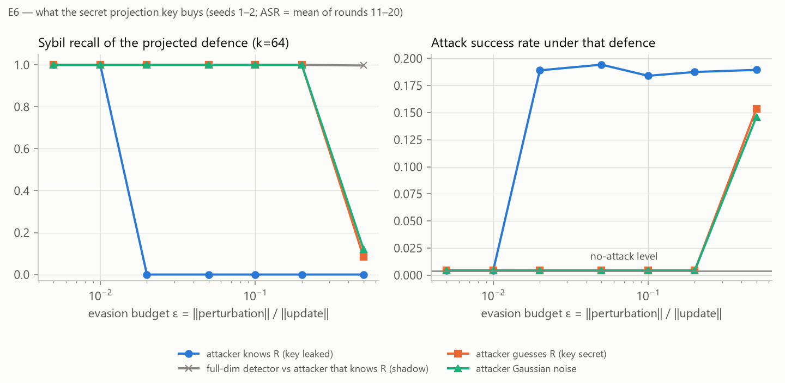

# Secure Sybil Detection in Federated Learning

Course project for Cryptography & Network Security (IIIT Kottayam).

A single-process federated-learning (FL) simulator in which an attacker runs several fake
clients (**Sybils**) that poison a shared model, and a server-side defence that catches them.
The defence compresses each client's model update with a **secret random projection whose matrix
is generated cryptographically** (HKDF-SHA256 round keys, keyed SHAKE-256 stream), then clusters
the compressed updates and drops suspiciously similar groups before averaging.

The study asks three questions:

1. Does the compressed (projected) detector catch Sybils as well as the same detector on the full
   updates?
2. Is it cheaper?
3. How much does keeping the projection key secret protect the detector against an attacker who
   tries to evade it?

> Research prototype. It is not a production defence and not a cryptographic proof. See
> [Security assumptions](#security-assumptions) and `docs/DECISIONS.md`.

---

## Contents

- [Results at a glance](#results-at-a-glance)
- [Requirements](#requirements)
- [Setup](#setup)
- [Check the installation](#check-the-installation)
- [Reproduce the results](#reproduce-the-results)
- [What to expect](#what-to-expect)
- [Reproducibility notes](#reproducibility-notes)
- [Running your own experiments](#running-your-own-experiments)
- [Output files](#output-files)
- [Troubleshooting](#troubleshooting)
- [Repository layout](#repository-layout)
- [Security assumptions](#security-assumptions)
- [Documentation](#documentation)

---

## Results at a glance

Setup: MNIST, small CNN (46,730 parameters), 20 honest clients with non-IID data (Dirichlet α =
0.5), 20 FedAvg rounds. 8 Sybils join and train on sevens labelled as ones. Attack success rate
(ASR) is the share of test sevens the model calls ones.

| Defence (held-out seeds 1–3) | Accuracy | ASR | Sybil detection F1 | False-positive rate |
|---|---|---|---|---|
| none, no attack | 0.983 | 0.004 | — | — |
| none (FedAvg), under attack | 0.962 | 0.182 | — | — |
| coordinate-wise median | 0.953 | 0.075 | — | — |
| full-dimensional detector | 0.983 | 0.004 | 0.989 | 0.009 |
| projected detector (k = 64) | 0.983 | 0.004 | 1.000 | 0.000 |

**What the secret key buys (E6).** Sybils perturb their updates to stop looking alike:

- **If the key leaks:** a perturbation of only **2%** of each update's size defeats the projected
  detector, and the attack regains full strength.
- **If the key stays secret:** the attacker's perturbation acts like random noise. Every Sybil is
  still caught up to **20%**, and evasion at 50% is only partial.



Full findings, limitations and all figures: `docs/RESULTS.md`, `results/summary/tables.md`,
`plots/`.

---

## Requirements

| | Minimum | Used for the published results |
|---|---|---|
| OS | Windows, Linux or macOS | Windows 11 |
| Python | 3.10 or newer | 3.12.10 |
| CPU | any (no GPU needed) | 16 logical cores |
| RAM | 4 GB (more for parallel workers, ~0.5 GB each) | 24 GB |
| Disk | ~1.5 GB (PyTorch ~1 GB, MNIST 64 MB, results ~3 MB) | |
| Network | to download PyTorch and MNIST once | |

Package versions used for the published results:

| torch | torchvision | numpy | scipy | scikit-learn | PyYAML | matplotlib | pytest |
|---|---|---|---|---|---|---|---|
| 2.14.1+cpu | 0.29.1+cpu | 2.5.2 | 1.18.1 | 1.9.1 | 6.0.3 | 3.11.2 | 9.1.1 |

Newer versions should work. Every result file records the versions it was produced with
(`meta.json` → `environment`).

---

## Setup

### 1. Get the code

```bash
git clone https://github.com/asw-beep/secure-sybil-detection-fl.git
cd secure-sybil-detection-fl
```

All commands below run from this folder, the one containing `pyproject.toml`.

### 2. Install

#### Windows: one click

Double-click `setup_windows.bat`, or run it from a terminal. It will:

1. Find Python.
2. Create `.venv`.
3. Install the CPU build of PyTorch.
4. Install this package with its test and plotting tools.
5. Download MNIST and run the sanity check E0.
6. Run the test suite.

The full log goes to `setup_log.txt`; the last line reads `SETUP OK` on success. Afterwards,
activate the environment in each new terminal:

```powershell
.venv\Scripts\activate
```

#### Windows: by hand (PowerShell)

```powershell
python -m venv .venv
.venv\Scripts\activate
pip install torch torchvision --index-url https://download.pytorch.org/whl/cpu
pip install -e ".[dev,plots]"
```

#### Linux

```bash
python3 -m venv .venv
source .venv/bin/activate
pip install torch torchvision --index-url https://download.pytorch.org/whl/cpu
pip install -e ".[dev,plots]"
```

#### macOS

```bash
python3 -m venv .venv
source .venv/bin/activate
pip install torch torchvision          # the default macOS wheels are CPU builds
pip install -e ".[dev,plots]"
```

Install PyTorch **before** the package. Otherwise pip may pull the much larger CUDA build on
Windows and Linux. The `plots` extra (matplotlib) is only needed to draw the figures.

---

## Check the installation

```bash
python experiments/run_central.py     # E0: downloads MNIST to data/ (~64 MB), trains centrally
pytest                                # full test suite
```

**Expected E0 output:**

- The client split covers all 60,000 training images exactly once.
- Test accuracy rises from about 0.10 to about **0.986** after 2 epochs.
- It takes about 1–2 minutes.

**Expected tests:** `167 passed`. Before MNIST is downloaded you will see `166 passed,
1 skipped`; the skipped test needs the real dataset.

Quick end-to-end check (3 federated rounds, under a minute):

```bash
python experiments/run_main.py --config configs/smoke.yaml
```

Live demo (about 1–2 minutes): double-click `demo.bat`, or run the two configs yourself:

```bash
python experiments/run_main.py --config configs/demo_attack.yaml --out results/demo/attack
python experiments/run_main.py --config configs/demo_defended.yaml --out results/demo/defended
```

Both runs use the label-flip attack (8 Sybils, 7 → 1) for 5 rounds. The first has no defence.
The second uses the projected detector at k = 64 with its tuned threshold τ = 0.15. In our run
the undefended ASR reached 0.064 by round 5. With the detector, every round flagged exactly
the 8 Sybils (tp 8, fp 0), and ASR stayed at or below 0.008. Keep the threshold tuned: with
the 0.5 from `label_flip.yaml`, the projected detector flags 26–28 of the 28 clients every round.

---

## Reproduce the results

The study has six steps. Every script writes into `results/`, and each run is saved as soon as it
finishes. If you stop a suite command and start it again, it skips the runs that are already done.

| Step | Command | Produces | Time on 16 logical cores |
|---|---|---|---|
| 1. Tune thresholds on seed 0 *(optional, see below)* | `python experiments/run_suite.py --group tune --workers 2 --threads 6` then `python experiments/tune_thresholds.py` | `configs/tuned_thresholds.yaml` | ~3 min |
| 2. E1/E2: defences, 3 held-out seeds | `python experiments/run_suite.py --group e2 --workers 6 --threads 2` | `results/suite/e2/` (24 runs) | ~28 min |
| 3. E3: label skew | `python experiments/run_suite.py --group e3 --workers 6 --threads 2` | `results/suite/e3/` (8 runs) | ~11 min |
| 4. E6: evasion | `python experiments/run_suite.py --group e6 --workers 6 --threads 2` | `results/suite/e6/` (42 runs) | ~49 min |
| 5. E5: runtime benchmark | `python experiments/run_scalability.py --threads 4` | `results/suite/e5/scalability.csv` | ~2 min |
| 6. Tables and figures | `python experiments/summarize.py` then `python experiments/make_plots.py` | `results/summary/`, `plots/` | seconds |

Total: about 1.5 hours on the machine above.

**Step 1 is optional.** The thresholds used for the published results are already committed in
`configs/tuned_thresholds.yaml`, and steps 2–4 read them from there.

- **Skip step 1** to reproduce the published runs with exactly the same thresholds.
- **Run step 1** to repeat the whole procedure. It overwrites the file, and the values may come
  out slightly different (see [Reproducibility notes](#reproducibility-notes)).

**Step 5 measures time,** so run it when nothing else is using the CPU.

**Fewer cores?** Keep `workers × threads` at or below your number of logical cores. For example,
use `--workers 3 --threads 2` on 8 cores; it takes about twice as long. Keep `--threads 2` for
steps 2–4 if you want to match the published runs as closely as possible.

Shell equivalents of the whole pipeline:

```bash
# Linux / macOS (bash)
for g in e2 e3 e6; do python experiments/run_suite.py --group $g --workers 6 --threads 2; done
python experiments/run_scalability.py --threads 4
python experiments/summarize.py && python experiments/make_plots.py
```

```powershell
# Windows (PowerShell)
foreach ($g in "e2", "e3", "e6") { python experiments/run_suite.py --group $g --workers 6 --threads 2 }
python experiments/run_scalability.py --threads 4
python experiments/summarize.py; python experiments/make_plots.py
```

`summarize.py` and `make_plots.py` regenerate the committed `results/summary/` and `plots/` from
your runs. Compare them with the committed versions, for example with `git diff --stat`.

---

## What to expect

Means over seeds; "±" is the spread you should expect between machines and runs.

| Check | Published value | Expect |
|---|---|---|
| E0 central accuracy (2 epochs) | 0.9859 | 0.985–0.987 |
| Clean FedAvg accuracy, rounds 11–20 | 0.983 | ±0.002 |
| Undefended ASR under attack, rounds 11–20 | 0.18 | **noisy**: ASR swings a lot between rounds; 0.1–0.3 is normal |
| ASR with either detector | 0.004 | ≤ 0.01 |
| Projected detector F1 / FPR (E2) | 1.000 / 0.000 | F1 ≥ 0.98, FPR ≤ 0.02 |
| E6: smallest budget that evades, attacker knows the key | ε = 0.02 | 0.01–0.02 |
| E6: smallest budget that evades, key secret | ε = 0.5 (fully detected at ≤ 0.2) | 0.2–0.5 |
| E3: false positives at α = 5 (full / projected) | 0.091 / 0.039 | same order |
| E5: break-even client count | 100–200 | **machine-dependent**; the trend (projection wins at large n) should hold |

Absolute timings (E5) depend on the CPU and the BLAS library. The shape of the curves matters,
not the milliseconds.

---

## Reproducibility notes

**Seeded.** One master `seed` in the config fixes every source of randomness:

- the data split and the attacker's pool;
- model initialisation;
- which clients are Sybils;
- every client's minibatch order;
- the evasion perturbations.

The suite uses seed 0 for tuning and seeds 1–3 for results.

**Not seeded by design: the server key.** Each run generates a fresh secret key, so the
projection matrices differ from run to run, as they would in deployment. Results involving the
projection therefore match statistically, not bit for bit. To make runs exactly repeatable,
supply a fixed key:

```powershell
# PowerShell
$env:SYBIL_FL_KEY = python -c "import secrets; print(secrets.token_hex(32))"
```

```bash
# bash
export SYBIL_FL_KEY=$(python -c "import secrets; print(secrets.token_hex(32))")
```

The key is 64 hex characters (32 bytes). It is never written to any output; only
`key_source: env` or `generated` is recorded. Do not commit it.

**Floating point.** Different CPUs, operating systems and thread counts can change results in the
last digits. For example, E0 gave 0.9864 on Linux and 0.9859 on Windows with the same seed. Small
differences in per-round numbers are expected; the conclusions above should not change.

---

## Running your own experiments

Every hyperparameter lives in `configs/default.yaml`. Unknown keys are rejected, so a typo cannot
silently fall back to a default.

| Section | Sets |
|---|---|
| `data` | number of clients, IID or Dirichlet split, α, attacker pool size |
| `train` / `fl` | batch size, learning rate, rounds, local epochs |
| `attack` | Sybil count, source and target class, samples per Sybil, evasion mode and budget |
| `projection` | k, and the generator (`shake256`, or `pcg64` for cost comparison only) |
| `defence` | aggregator (`fedavg` or `median`), detector (`none`, `full` or `projected`), threshold τ, minimum cluster size |
| `evaluation` | shadow scoring: k values and thresholds scored without affecting training |

To run your own configuration, copy a config file, edit it and run:

```bash
python experiments/run_main.py --config my_config.yaml --out results/my_run
```

`configs/label_flip.yaml` is the default attack: 8 Sybils, 7 → 1, with no defence.

Running tests:

```bash
pytest                                   # everything
pytest tests/test_crypto.py              # one file (HKDF against the RFC 5869 test vectors)
pytest tests/test_detector.py::test_detect_is_order_invariant   # one test
pytest -m "not mnist"                    # skip the test that needs the real dataset
```

---

## Output files

Each federated run folder contains:

| File | Contents |
|---|---|
| `rounds.csv` | one row per round: `test_acc`, `asr`, `mean_train_loss`, clients total/aggregated, `flagged`, `tp`/`fp`/`fn`/`tn`, `skipped`, `evasion_rel_norm`, detector timings |
| `meta.json` | full config, overrides, seed, library versions, data split sizes, Sybil ids (ground truth), key source, and a `summary` (last-half means, micro-averaged detection scores) |
| `shadow_detection.csv` | when shadow scoring is on: detection counts per round × method × k × τ |
| `shadow_similarity.csv` | when shadow scoring is on: projected-vs-full cosine error and group similarities per round × k |

`results/suite/` (raw runs) is git-ignored. `results/summary/` and `plots/` are generated from it
and are committed.

---

## Troubleshooting

| Problem | Fix |
|---|---|
| `setup_windows.bat` says Python not found | Install Python 3.10+ from python.org and tick "Add to PATH". The script tries the `py` launcher first and falls back to `python`. |
| pip downloads gigabytes of CUDA libraries | You installed the package before PyTorch. Run `pip install torch torchvision --index-url https://download.pytorch.org/whl/cpu` first. |
| MNIST download fails | Retry; torchvision tries several mirrors. Or put the four MNIST files in `data/MNIST/raw/`. |
| `ModuleNotFoundError: sybil_fl` | Activate `.venv`, and install with `pip install -e ".[dev,plots]"` from the repository root. |
| `ModuleNotFoundError: matplotlib` | `pip install -e ".[plots]"` |
| `configs/tuned_thresholds.yaml not found` | Run step 1, or restore the committed file with `git checkout configs/tuned_thresholds.yaml`. |
| The suite is very slow, or the machine is unresponsive | Too many workers or threads: lower `--workers` / `--threads` so their product fits your cores. |
| A run failed | The suite keeps going and writes the traceback to that run's `error.txt`. Rerun the same command and only missing runs are repeated. |
| `SYBIL_FL_KEY is not valid hex` | The key must be exactly 64 hex characters. |

---

## Repository layout

```
configs/                default.yaml (every hyperparameter), smoke.yaml, label_flip.yaml,
                        demo_attack.yaml, demo_defended.yaml (used by demo.bat),
                        tuned_thresholds.yaml (written by tune_thresholds.py)
src/sybil_fl/
  config.py             typed YAML config; unknown keys are errors
  data.py               MNIST loading, attacker pool, IID / Dirichlet client splits + coverage check
  models.py             small CNN (d = 46,730) and flat-parameter helpers
  training.py           seeded SGD training and accuracy evaluation
  client.py             local training -> the client's update
  crypto.py             HKDF-SHA256 (RFC 5869), per-round keys, server key loading
  projection.py         secret ±1/sqrt(k) projection matrix from keyed SHAKE-256
  detector.py           cosine similarity + average-linkage clustering, full or projected
  aggregators.py        FedAvg, coordinate-wise median
  attacks.py            Sybil selection, label flipping, evasion perturbations
  metrics.py            attack success rate, detection precision / recall / F1 / FPR
  evaluation.py         shadow scoring, projection distortion
  server.py             one FL round: evasion -> detection -> filtered aggregation -> logging
  experiment.py         runs one experiment end to end and summarises it
experiments/            run_central.py (E0), run_main.py (one run), run_suite.py (the study),
                        tune_thresholds.py, run_scalability.py (E5), summarize.py, make_plots.py
tests/                  pytest suite (167 tests)
docs/                   RESULTS.md, DECISIONS.md, PROGRESS.md, EXECUTION_PLAN.md
results/summary/        generated result tables (committed)
plots/                  generated figures (committed)
setup_windows.bat       one-click Windows setup
demo.bat                two-run live demo (attack undefended, then projected detector)
```

---

## Security assumptions

- **Server:** trusted, and holds a 32-byte master key `K`.
- **Attacker:** controls the Sybils and knows the algorithm and all public parameters, but not
  `K`. It sees no detection feedback.
- **Per-round matrix:**
  - The round key is `K_t = HKDF-SHA256(K, info = "sybil-fl|projection|v1|round=t")`.
  - The matrix `R_t` has entries ±1/√k; its signs are the bits of `SHAKE-256(K_t || shape label)`.

**What is claimed:** under the standard assumptions that HMAC-SHA256 and keyed SHAKE-256 behave
like pseudorandom functions, `R_t` cannot be predicted or distinguished from random without `K`,
and it is independent across rounds. That removes one attack route, crafting updates against a
known projection, and E6 measures how much it matters.

**What is not claimed:**

- that the detector resists adaptive attackers in general;
- any formal proof;
- that the HKDF → keyed SHAKE-256 composition has been externally reviewed. KMAC256 would be the
  standardised alternative.

`K` and the round keys are never written to results or logs, and a test checks this. Further
limitations: the server sees individual updates (no secure aggregation), and creating Sybil
identities is not prevented; only their colluding updates are detected. See `docs/RESULTS.md` for
the full list.

---

## Documentation

| File | What it holds |
|---|---|
| `docs/RESULTS.md` | findings, verdicts on the hypotheses, limitations, figure index, references |
| `docs/DECISIONS.md` | design decisions D1–D12 and why (D3/D4 cryptography, D9 attacker data, D10 evasion attacker, D11 detector) |
| `docs/PROGRESS.md` | step-by-step build log with tests and results |
| `results/summary/tables.md` | every result table, generated from the runs |
